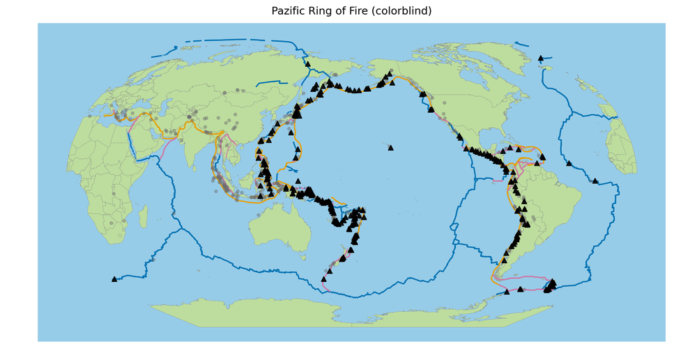
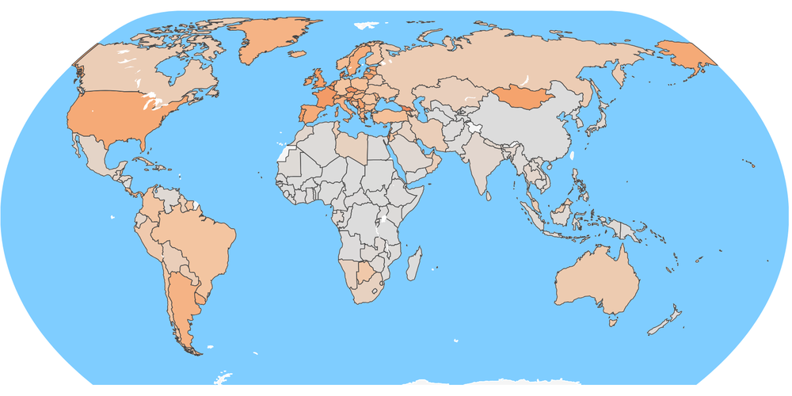
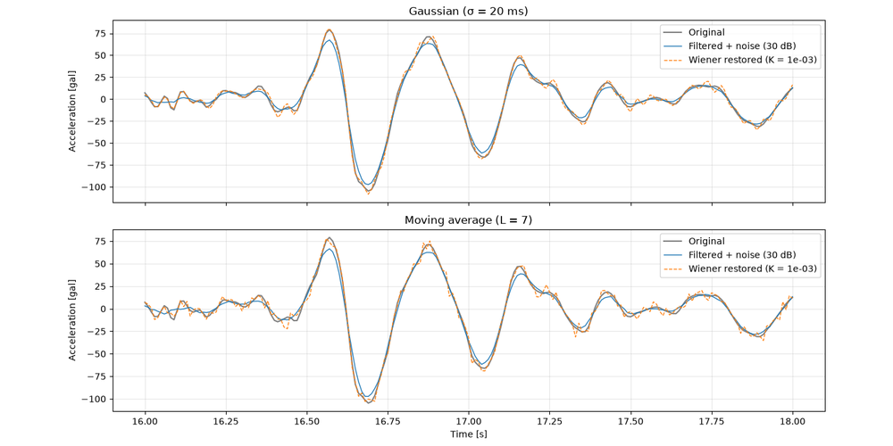
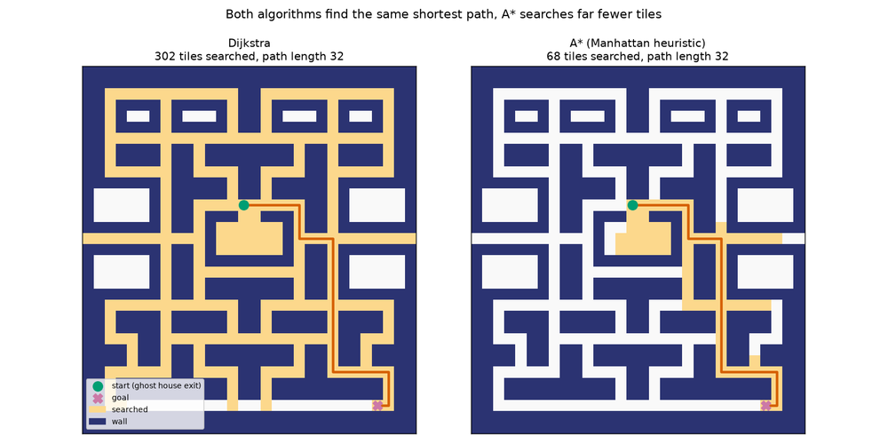
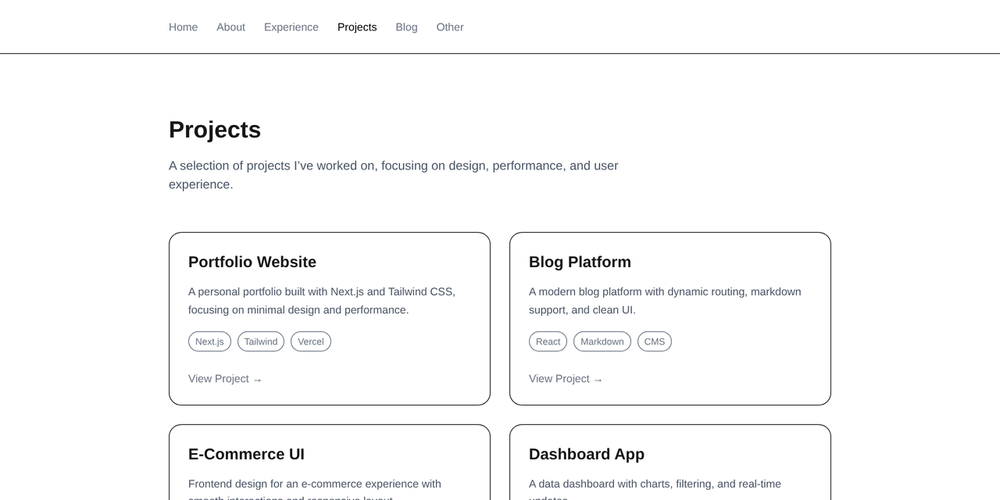

<h1 align="center">Hi, I'm Mischa 👋</h1>

  BSc student in <b>Data Science &amp; AI</b> at <a href="https://github.com/FHNW">FHNW</a> · Switzerland 🇨🇭

  
  
  
  
  
  

I work on data analysis, visualization and AI projects during my studies, and build web projects on the side.

---

## 🚀 Featured projects

<table>
  <tr>
    <td width="50%" valign="top">
      
      <h3><a href="https://github.com/mischhart-bsc/seismic-tsunami-risk-assessment">🌊 Seismic &amp; Tsunami Risk Assessment</a></h3>
      Where do tsunami-generating earthquakes happen? A colour-blind-safe geovisualization of 782 large earthquakes and plate boundaries, with project report and presentation.  
      
      
      
    </td>
    <td width="50%" valign="top">
      
      <h3><a href="https://github.com/mischhart-bsc/covid-19-spread-world-map">🦠 Covid-19 Spread World Map</a></h3>
      Interactive dashboard of the pandemic from 2020 to 2026: world map with time slider, hotspot timeline and colour-vision modes.  
      
      
      
    </td>
  </tr>
  <tr>
    <td width="50%" valign="top">
      
      <h3><a href="https://github.com/mischhart-bsc/seismic-signal-processing">📈 Seismic Signal Processing</a></h3>
      Sampling, correlation and convolution on a real earthquake record: how fast must a sensor sample, and how much of a smoothed peak can a Wiener filter restore?  
      
      
      
    </td>
    <td width="50%" valign="top">
      
      <h3><a href="https://github.com/mischhart-bsc/pacman-search-optimization">👻 Pacman Search Optimization</a></h3>
      Pacman ghosts that hunt with shortest-path search. A heap-based priority queue, Dijkstra and A* are written from scratch, and A* searches about 3.6 times fewer tiles.  
      
      
      
    </td>
  </tr>
  <tr>
    <td width="50%" valign="top">
      
      <h3><a href="https://github.com/mischhart-bsc/portfolio">💼 Portfolio Website</a></h3>
      Personal portfolio built with Next.js and TypeScript, deployed on Vercel.
      <a href="https://my-portfolio-five-xi-13.vercel.app">Live demo →</a>
      A second version with a database is built with Django: <a href="https://github.com/mischhart-bsc/django-portfolio">django-portfolio</a>.  
      
      
      
    </td>
    <td width="50%" valign="top">
      <h3><a href="https://github.com/mischhart-bsc/agentic_ai">🤖 Agentic AI for EDA</a></h3>
      Agentic AI system that automates exploratory data analysis (EDA) with a local LLM, built as a team project.  
      
      
      
    </td>
  </tr>
</table>

---

## 📫 Find me here

